# MOOMOO-OPEND-TradeStation

<p align="center">
  <b>Automated, Strategy-Driven Quantitative Trading Platform & Autonomous Execution Engine</b><br>
  <i>Powered strictly by your local Moomoo OpenD gateway on macOS Apple Silicon (Metal / wgpu)</i>
</p>

<p align="center">
  <a href="https://www.rust-lang.org/"></a>
  <a href="https://developer.apple.com/metal/"></a>
  <a href="https://wgpu.rs/"></a>
  <a href="https://github.com/EmbarkStudios/cargo-deny"></a>
  <a href="https://www.moomoo.com/"></a>
  <a href="LICENSE"></a>
</p>

---

<p align="center">
  
</p>

---

## Table of Contents
- [Executive Overview](#executive-overview)
- [System Architecture](#system-architecture)
- [Quantitative Engine & Strategy Lab](#quantitative-engine--strategy-lab)
  - [1. DRBT-Grid Algorithmic Strategy](#1-drbt-grid-algorithmic-strategy)
  - [2. Causal Next-Bar Execution (Zero Lookahead Bias)](#2-causal-next-bar-execution-zero-lookahead-bias)
  - [3. Autonomous Paper Bot & Single-Position-Per-Symbol Constraint](#3-autonomous-paper-bot--single-position-per-symbol-constraint)
  - [4. Statistical Evidence Promotion Gates & Auto-Switch Safeguards](#4-statistical-evidence-promotion-gates--auto-switch-safeguards)
  - [5. Apple Silicon Multi-Core Thermal Governor](#5-apple-silicon-multi-core-thermal-governor)
- [Charting & Visual Workspace](#charting--visual-workspace)
  - [Dual Charting Architecture (Real Fills vs Simulated Backtests)](#dual-charting-architecture-real-fills-vs-simulated-backtests)
  - [151 Native Closed-Form DSP Indicators](#151-native-closed-form-dsp-indicators)
  - [Fully Persistent Docking Workspace](#fully-persistent-docking-workspace)
- [Strict Security & Privacy Isolation](#strict-security--privacy-isolation)
- [Quickstart Guide](#quickstart-guide)
  - [Prerequisites](#prerequisites)
  - [Connecting to Local OpenD](#connecting-to-local-opend)
  - [Running the Application](#running-the-application)
- [Command Line & Navigation Shortcuts](#command-line--navigation-shortcuts)
- [Testing & Quality Assurance](#testing--quality-assurance)
- [Search & Discovery Index](#search--discovery-index)

---

## Executive Overview

**MOOMOO-OPEND-TradeStation** is a high-performance, autonomous quantitative trading station built in pure Rust. It transforms your local Moomoo OpenD desktop gateway (`127.0.0.1:11111`) into an institutional-grade algorithmic execution system. 

Unlike conventional manual charting tools, TradeStation is fundamentally **automated, strategy-driven, and AI-optimized**:
1. **Autonomous Paper Execution**: Manages live multi-symbol portfolios with strict single-position-per-symbol invariants, dynamic trailing stops, and session lifecycle state machines.
2. **Causal Next-Bar Engine**: Rigorous backtesting and real-time execution with strictly zero lookahead bias (orders queued on candle close, filled at next bar open with slippage).
3. **Hardware-Accelerated Charting**: Native `wgpu` Metal graphics pipeline rendering 1,000,000+ bars smoothly at 120 FPS.
4. **Apple Silicon Thermal Governance**: Scoped multi-threading pinning parallel hyperparameter sweeps across efficiency cores (E-cores) with Darwin background QoS to prevent CPU throttling.
5. **Zero External Cloud / Complete Privacy**: 100% loopback-bound. Zero third-party web scrapers, zero analytics, zero telemetry, and zero unvetted remote dependencies.

---

## System Architecture

```mermaid
flowchart TD
    subgraph Local_Host ["Local Computer (Zero External Network Traffic)"]
        OpenD["Moomoo OpenD Daemon\n(127.0.0.1:11111)"]
        
        subgraph TradeStation_Engine ["TradeStation Pure Rust Engine"]
            MDClient["tr-moomoo\nLoopback Firewall & Watchlist Gatekeeper"]
            Router["tr-data\nQuote & Historical Candle Pipeline"]
            
            subgraph Strategy_Lab ["crates/strategy (DRBT-Grid & Bot)"]
                Backtester["Next-Bar Backtester\n(Zero Lookahead Bias)"]
                Optimizer["Interval Sweep & AI Proposer\n(E-Core Thermal Governor)"]
                EvidenceGate["Evidence Promotion Gate\n(min 5 trades, multi-session)"]
                PaperBot["Paper Trading Bot\n(1 Position / Symbol Invariant)"]
            end
            
            subgraph Presentation ["Desktop UI (app)"]
                UI["Dockable Workspace & Palette (egui)"]
                Chart["GPU Metal Chart (wgpu)\nWatchlist (GP) vs Backtest (BT)"]
            end
        end
    end
    
    OpenD <-->|"Local TCP / Protobuf"| MDClient
    MDClient --> Router
    Router --> Backtester
    Router --> PaperBot
    Backtester --> Optimizer
    Optimizer --> EvidenceGate
    EvidenceGate -.->|"Manual Approval"| PaperBot
    PaperBot --> Chart
    Router --> Chart
    Chart --> UI
```



---

## Quantitative Engine & Strategy Lab

### 1. DRBT-Grid Algorithmic Strategy
The core quantitative model implemented in `crates/strategy` is the **Dynamic Range-Break Trend Grid (DRBT-Grid)**:
- **Rolling Quantization**: Continuously quantizes an adaptive rolling lookback window (5–120 periods) into dynamic quartile price bands.
- **Regime Identification**: Detects dynamic range expansion, channel breakdowns, and mean-reversion boundary crossings.
- **Asymmetric Risk Management**: Combines hard stop losses, multi-target take profits, and dynamic trailing stops that arm automatically once minimum favorable excursion (MFE) thresholds are satisfied.

### 2. Causal Next-Bar Execution (Zero Lookahead Bias)
All backtesting sweeps and real-time paper strategies operate strictly under causal next-bar execution:
- **No Same-Bar Peeking**: Signals generated on the close of bar $i$ are queued as `pending_buy = true`.
- **Realistic Next-Open Fill**: The position is opened exclusively at bar $i+1$'s `open` price, incorporating simulated realistic slippage ($+0.02\%$).
- **Session Boundaries**: Intraday trades respect session open delays and liquidation windows, completely eliminating historical lookahead artifacts.

### 3. Autonomous Paper Bot & Single-Position-Per-Symbol Constraint
The autonomous execution bot ([`PaperTradingBot`](crates/strategy/src/bot.rs)) manages live paper trading across your watchlist:
- **Strict Single Position Per Symbol**: Tracks active positions via `positions: HashMap<String, PaperPosition>`. Under no circumstances can a symbol stack, pyramid, or open a second position while one is already active.
- **Concurrent Portfolio Evaluation**: The bot monitors exits, trailing stops, and session wind-down liquidations across all held symbols in parallel, regardless of which symbol is currently focused in the UI.
- **Real-Time Projection**: Switching between symbols in the UI seamlessly displays the active symbol's position, entry price, and peak price, with visual `🟢` badges indicating open positions on the symbol bar.
- **Session Lifecycle Governance**:
  - `🌙 IDLE (Off-Session)` (17:00–08:30 ET & Weekends): Dormant; consumes zero CPU or network bandwidth.
  - `🌅 WAKING UP (Pre-Session)` (08:30–09:30 ET): Wakes up 1 hour prior to open to ingest pre-market quotes and establish baseline grid levels. Zero entries permitted.
  - `⚡ OPEN SESSION (Active)` (09:30–16:00 ET): Executes algorithmic entries and tracks dynamic intrabar exits.
  - `🌆 POST-SESSION (Wind-Down)` (16:00–17:00 ET): Systematically liquidates open intraday positions and settles daily balances.

### 4. Statistical Evidence Promotion Gates & Auto-Switch Safeguards
TradeStation protects traders against overfitting and noise-driven parameter switching:
- **Sample Size Safeguard (`MIN_PROMOTION_TRADES = 5`)**: A strategy candidate must produce at least 5 executed trades over multi-session evaluation. Strategies with 2 trades over 5 days are strictly rejected as statistically insignificant.
- **Auto-Switching Kept OFF**: Automatic background strategy swapping is permanently disabled. Optimized parameter configurations require explicit trader verification and manual promotion via the `🚀 PROMOTE WINNER TO PAPER` button.
- **Active Position Promotion Lock**: Strategy configurations cannot be altered or promoted while holding an open position in the target symbol.

### 5. Apple Silicon Multi-Core Thermal Governor
Hyperparameter optimization sweeps across thousands of candidate parameter sets evaluate without slowing down your Mac:
- **Efficiency Core (E-Core) Concurrency**: Parallel sweep threads run on Darwin background Quality of Service (`QOS_CLASS_BACKGROUND: 0x09`), targeting efficiency cores.
- **Thermal Hotspot Defense**: Workloads distribute evenly across available E-cores (e.g. 6 E-cores on Apple M4), leaving Performance (P) cores cool and preventing CPU fan throttling.

---

## Charting & Visual Workspace

### Dual Charting Architecture (Real Fills vs Simulated Backtests)
Operational clarity is preserved through strict physical chart separation:
1. **Standard Watchlist Chart (`GP`)**:
   - Displays real and paper historical executed order fills directly on candlestick bars.
   - **Buy Fills (`B`)**: Green circle badge anchored below candle lows.
   - **Sell Fills (`S`)**: Red circle badge anchored above candle highs.
   - **Interactive Hover Cards**: Displays execution price, filled shares, total dollar notional, UTC timestamp, and order ID.
   - Zero simulated backtest markers are ever shown on operational watchlist charts.
2. **Dedicated Backtest Runner Pane (`BT`)**:
   - Tabbed separately as `🔬 BACKTEST RUNNER · SYMBOL · ★ Interval · Simulated Trades`.
   - Visualizes theoretical entry and exit markers for winning optimization candidates.

### 151 Native Closed-Form DSP Indicators
100% computed in native Rust using closed-form analytical formulas and digital signal processing (zero external indicator APIs):
- **Moving Averages**: SMA, EMA, WMA, HMA, DEMA, TEMA, KAMA, Ehlers SuperSmoother.
- **Volatility Bands**: Bollinger Bands, Keltner Channels, Donchian Channels, Average True Range (ATR).
- **Momentum Oscillators**: RSI, MACD, Stochastic Oscillator, CCI, Williams %R.
- **Institutional Levels**: VWAP, Camarilla Pivots, Fibonacci Retracements.

### Fully Persistent Docking Workspace
- **Dockable Panels**: Tiling, horizontal/vertical splitting, tabbed groupings, and detached floating windows powered by `egui_dock`.
- **Layout Lifecycle**: Save, switch, and delete named layouts via the UI (`Layouts › Delete Layout...`) or terminal command line (`DELETE LAYOUT <NAME> <GO>`).
- **Atomic Persistence**: Watchlists, layout geometries, theme selections, and paper balances persist atomically to local application storage.

---

## Strict Security & Privacy Isolation

TradeStation is engineered from the ground up for absolute institutional isolation:
- **Local Loopback Enforcement**: All network connections are validated by `validate_loopback_only`. Non-loopback IPs, remote hostnames, and unauthorized schemes are rejected.
- **Watchlist Gatekeeper**: Quotes and historical candlestick requests are strictly restricted to instruments in your Moomoo account watchlist.
- **Banned Protocols & Webhooks**: Connections via SSH, FTP, SFTP, Telnet, or SMTP and outgoing webhooks (Discord, Slack, arbitrary endpoints) are blocked at the socket layer.
- **Zero Third-Party Telemetry**: Sparkle auto-updaters, crash analytics, and remote telemetry tracking have been permanently excised.
- **Dependency Supply-Chain Lock**: Enforced by [`cargo-deny`](deny.toml) in CI and pre-push git hooks, banning weak cryptography and undeclared network dependencies.
- **macOS Hardened Runtime**: Bundled with Apple Hardened Runtime (`--options runtime`, flags `0x10000`) and strict Library Validation to prevent `.dylib` hijacking.

---

## Quickstart Guide

### Prerequisites
- macOS 14.0+ (Apple Silicon recommended: M1, M2, M3, M4)
- Rust 1.85+ (`curl --proto '=https' --tlsv1.2 -sSf https://sh.rustup.rs | sh`)
- Moomoo OpenD desktop application running locally

### Connecting to Local OpenD
1. Open your local **Moomoo Desktop Application** or launch **Moomoo OpenD**.
2. Enable OpenD API access (default listen address: `127.0.0.1:11111`).
3. Authentication is managed securely on your local machine; zero API secret keys are stored in this repository.

### Running the Application
```sh
# Clone repository
git clone https://github.com/ProperProperProper/MOOMOO-OPEND-TradeStation.git
cd MOOMOO-OPEND-TradeStation

# Build and run with Metal GPU acceleration
cargo run --release

# Specify custom OpenD address if non-default
MOOMOO_OPEND_ADDR=127.0.0.1:11111 cargo run --release

# Run in fully offline sample mode (no OpenD required)
TR_PROVIDER=sample cargo run --release
```

---

## Command Line & Navigation Shortcuts

Pressing `Enter` functions as `<GO>`:

| Command | Action |
|---|---|
| `<SYMBOL> <GO>` | Load chart for watchlist symbol (e.g., `MRNA <GO>`, `NVDA <GO>`) |
| `<SYMBOL> GP <GO>` | Open standard watchlist price chart with executed fills |
| `<SYMBOL> BT <GO>` | Open dedicated backtest runner chart with simulated trades |
| `<SYMBOL> STRAT <GO>` or `AI <GO>` | Open AI Quantitative Bot & Strategy Lab |
| `SAVE LAYOUT <NAME> <GO>` | Save the active pane and dock configuration |
| `DELETE LAYOUT <NAME> <GO>` | Delete a saved layout |
| `HELP <GO>` or `F1` | Show hotkeys, commands, and indicator palette |

---

## Testing & Quality Assurance

```sh
# Run full library test suite
cargo test --workspace --lib

# Run live causal next-bar backtest verification across watchlist symbols
cargo test -p terminal --test test_live_backtest

# Run policy-based supply-chain and dependency audit
./scripts/supply-chain-audit.sh

# Full workspace compilation and linting check
cargo check --workspace
```

---

## Search & Discovery Index

`algorithmic-trading` · `quantitative-finance` · `moomoo-opend` · `trading-bot` · `rust` · `gpu-charting` · `metal` · `wgpu` · `automated-trading-system` · `backtesting-engine` · `paper-trading` · `strategy-optimization` · `drbt-grid` · `apple-silicon` · `fintech` · `risk-management` · `technical-analysis` · `egui` · `market-data` · `stock-trading`
